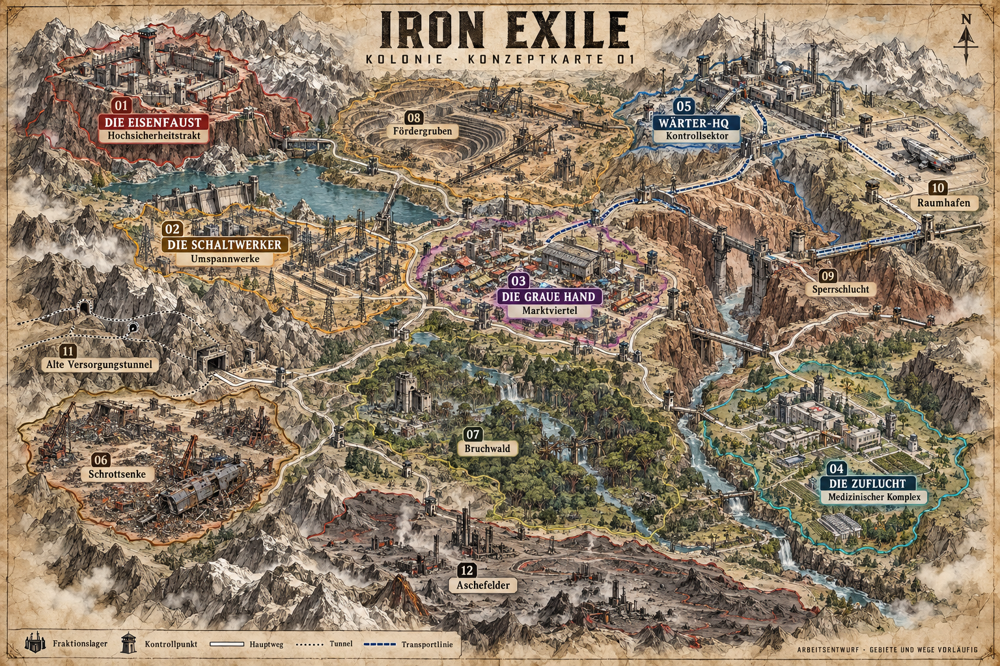

# Konzeptkarte 01 – Kolonie

**Stand:** 01.11.2026 · **Status:** GESETZT als räumliche Konzeptgrundlage (DEC-013) · **Phase:** Storyplanung

Die Karte zeigt einen möglichen spielbaren Kolonieausschnitt, nicht den gesamten Planeten. Die vier Fraktionsnamen und Grundprofile sind bestätigt. Gebietsnamen, grobe Geografie, Lagerpositionen und dargestellte Verbindungen sind als räumliches Konzept bestätigt (DEC-013). Ausgearbeitete Architektur, exakte Grenzen und Wegdetails bleiben offen. Größenverhältnisse sind illustrativ; kein verbindlicher Maßstab oder fertiger Levelplan.

| Nr. | Gebiet | Zugehörigkeit / Funktion im Entwurf |
|---|---|---|
| 01 | Hochsicherheitstrakt | Die Eisenfaust; befestigtes Plateau |
| 02 | Umspannwerke | Die Schaltwerker; Energieversorgung und Wartung |
| 03 | Marktviertel | Die Graue Hand; zentraler Handels- und Verkehrsknoten |
| 04 | Medizinischer Komplex | Die Zuflucht; geschütztes Tal mit Versorgungseinrichtungen |
| 05 | Kontrollsektor | Wärter-HQ; gesicherte Hochlage |
| 06 | Schrottsenke | Bergung und technische Ressourcen; Kontrolle offen |
| 07 | Bruchwald | Wildnis, Ruinen und Flusswege; Kontrolle offen |
| 08 | Fördergruben | Rohstoffabbau; Kontrolle offen |
| 09 | Sperrschlucht | Kontrollierte Übergänge zwischen Kolonie und gesicherter Zone |
| 10 | Raumhafen | Gesicherte Transportanlagen; konkrete Rolle im Finale offen |
| 11 | Alte Versorgungstunnel | Alternative Verbindungen; Zugang und Kontrolle offen |
| 12 | Aschefelder | Gefährliche Industriebrache; Kontrolle offen |

## Räumliche Idee

Ein zentraler Markt verbindet die Kolonie, während Berge, Fluss und Schluchten Wege begrenzen. Unterschiedlich große Gebiete bieten Platz für Erkundung und spätere Machtkämpfe. Tunnel eröffnen alternative Verbindungen. Der Raumhafen bleibt räumlich vom offenen Koloniegebiet getrennt. Daraus sind noch keine unumgehbaren Quest- oder Kapitelbedingungen abgeleitet.

Die Territoriumsfarben zeigen konzeptionelle Gebietszuordnungen; sie definieren keine bereits beschlossene Kriegssimulation. Der Spitzelpfad bleibt zurückgestellt. Eine Startposition des Helden ist noch nicht festgelegt.

## Erstellung

Erstellt mit dem eingebauten Imagegen-Werkzeug. Das vom Nutzer bereitgestellte Gothic-Kartenbild diente als grobe visuelle Referenz für handgezeichnete Topografie und Wege, nicht als zu übernehmender Grundriss. Der vollständige Generierungsprompt liegt in PROMPT_KONZEPTKARTE_01.txt.
